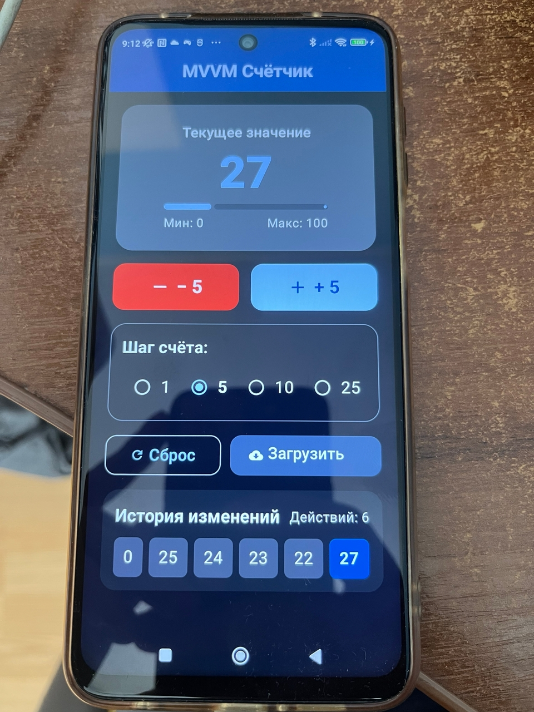

# Отчёт по лабораторной работе №5

## «Архитектура Android-приложений. MVVM и StateFlow»

## Сведения о студенте

- **ФИО:** Лебский Артём Александрович
- **Группа:** Пин-б-о-24-1
- **Курс:** 3
- **Семестр:** 1
- **Дата выполнения:** 2026-11-02
- **Дисциплина:** Программирование мобильных устройств
- **ОС разработки:** Windows 11
- **Целевое устройство тестирования:** Xiaomi Redmi Note 9 Pro (Android)

---

## 1. ЦЕЛЬ РАБОТЫ

1. Изучить архитектурный паттерн **MVVM** (Model-View-ViewModel).
2. Освоить работу с **StateFlow** и **MutableStateFlow** для реактивного программирования.
3. Научиться использовать **ViewModel** для хранения состояния и изоляции бизнес-логики от пользовательского интерфейса.
4. Реализовать сохранение состояния приложения при изменении конфигурации (поворот экрана) и вытеснении процесса через **SavedStateHandle**.
5. Подготовить основу для дальнейшей работы с локальной базой данных (Room).

---

## 2. ЗАДАЧИ РАБОТЫ

Выполнены все базовые требования и блок заданий повышенной сложности на оценку **«Отлично»**:

1. Подключены зависимости `lifecycle-viewmodel-compose`, `lifecycle-runtime-compose` и корутины.
2. Спроектирован и создан data-класс `CounterState` с неизменяемыми полями (`count`, `step`, `maxValue`, `minValue`, `history`, `isLoading`).
3. Разработан класс `CounterViewModel` с инкапсулированным `MutableStateFlow` и публичным `StateFlow`.
4. Реализованы методы изменения состояния: `increment()`, `decrement()`, `reset()`, `setStep(newStep)`.
5. Реализована имитация асинхронной загрузки начального значения (`loadInitialValue`) с использованием корутин (`viewModelScope.launch` и `delay`).
6. Реализован экран `CounterScreen` на Jetpack Compose с подпиской на состояние через `collectAsState()`.
7. Добавлен выбор величины шага (1, 5, 10, 25) с помощью группы `RadioButton`.
8. Добавлена плавная анимация изменения чисел на экране с использованием `AnimatedContent`.
9. Реализовано ведение **истории изменений** с горизонтальным отображением последовательности значений.
10. Реализован контроль граничных значений: максимальный лимит (100) и нижний порог (0) с наглядным прогресс-баром.
11. Интегрировано сохранение и восстановление состояния через **SavedStateHandle** на случай уничтожения процесса системой.
12. Все классы и методы задокументированы в формате **KDoc**.
13. Разработан набор модульных тестов (`CounterViewModelTest`) для верификации логики счётчика.
14. Выполнена сборка и установка приложения на реальное мобильное устройство Xiaomi Redmi Note 9 Pro.

---

## 3. АРХИТЕКТУРА ПРИЛОЖЕНИЯ (MVVM)

В проекте строго соблюдён принцип однонаправленного потока данных (Unidirectional Data Flow):

```
┌────────────────────────────────────────────────────────┐
│                        VIEW                            │
│  CounterScreen (Jetpack Compose UI)                    │
│  - Отображает текущее состояние (Text, Buttons, Card)  │
│  - Подписан на поток через collectAsState()            │
│  - Отправляет события действий (intent/events)         │
└───────────────────────┬──────────────▲─────────────────┘
                        │              │
        События (Events)│              │ Реактивное состояние
        onClick()       │              │ StateFlow<CounterState>
                        ▼              │
┌──────────────────────────────────────┴─────────────────┐
│                      VIEWMODEL                         │
│  CounterViewModel                                      │
│  - Хранит MutableStateFlow<CounterState>               │
│  - Обрабатывает бизнес-логику (+, -, reset, step)      │
│  - Выполняет асинхронные корутины (viewModelScope)     │
│  - Синхронизирует данные с SavedStateHandle            │
└───────────────────────┬──────────────▲─────────────────┘
                        │              │
       Чтение/сохранение│              │ Восстановление данных
                        ▼              │
┌──────────────────────────────────────┴─────────────────┐
│                        MODEL                           │
│  CounterState (неизменяемое состояние)                 │
│  SavedStateHandle (системное хранилище бандла)         │
└────────────────────────────────────────────────────────┘
```

---

## 4. СТРУКТУРА ПРОЕКТА

```
lab0502/
├── app/
│   ├── build.gradle.kts
│   └── src/
│       ├── main/
│       │   ├── AndroidManifest.xml
│       │   └── java/com/example/counter/
│       │       ├── MainActivity.kt               # Точка входа в приложение
│       │       ├── data/
│       │       │   └── CounterState.kt           # Модель состояния UI
│       │       ├── viewmodel/
│       │       │   └── CounterViewModel.kt       # ViewModel с бизнес-логикой
│       │       └── ui/
│       │           ├── CounterScreen.kt          # Composable-интерфейс экрана
│       │           └── theme/                    # Цвета, шрифты, Material3-тема
│       │               ├── Color.kt
│       │               ├── Theme.kt
│       │               └── Type.kt
│       └── test/
│           └── java/com/example/counter/
│               └── CounterViewModelTest.kt       # Модульные тесты
├── build.gradle.kts
└── settings.gradle.kts
```

---

## 5. ИСХОДНЫЙ КОД КЛЮЧЕВЫХ КОМПОНЕНТОВ

### 5.1. Модель состояния `CounterState.kt`

```kotlin
package com.example.counter.data

/**
 * Неизменяемое состояние экрана счётчика.
 *
 * @property count Текущее числовое значение счётчика.
 * @property step Величина шага изменения счётчика при нажатии на кнопки (1, 5, 10, 25).
 * @property maxValue Максимально допустимое значение счётчика (по умолчанию 100).
 * @property minValue Минимально допустимое значение счётчика (по умолчанию 0).
 * @property history Список предыдущих зафиксированных значений счётчика.
 * @property isLoading Флаг фоновой асинхронной загрузки данных.
 *
 * @author Лебский Артём Александрович
 * @since 2026-11-02
 */
data class CounterState(
    val count: Int = 0,
    val step: Int = 1,
    val maxValue: Int = 100,
    val minValue: Int = 0,
    val history: List<Int> = emptyList(),
    val isLoading: Boolean = false
)
```

### 5.2. Бизнес-логика и ViewModel `CounterViewModel.kt`

```kotlin
package com.example.counter.viewmodel

import androidx.lifecycle.SavedStateHandle
import androidx.lifecycle.ViewModel
import androidx.lifecycle.viewModelScope
import com.example.counter.data.CounterState
import kotlinx.coroutines.delay
import kotlinx.coroutines.flow.MutableStateFlow
import kotlinx.coroutines.flow.StateFlow
import kotlinx.coroutines.flow.asStateFlow
import kotlinx.coroutines.flow.update
import kotlinx.coroutines.launch

/**
 * ViewModel для управления состоянием и бизнес-логикой экрана счётчика.
 */
class CounterViewModel(
    private val savedStateHandle: SavedStateHandle = SavedStateHandle()
) : ViewModel() {

    companion object {
        private const val KEY_COUNT = "counter_count"
        private const val KEY_STEP = "counter_step"
        private const val KEY_HISTORY = "counter_history"
    }

    private val restoredCount: Int = savedStateHandle[KEY_COUNT] ?: 0
    private val restoredStep: Int = savedStateHandle[KEY_STEP] ?: 1
    private val restoredHistory: List<Int> = savedStateHandle.get<ArrayList<Int>>(KEY_HISTORY)?.toList() ?: listOf(restoredCount)

    private val _state = MutableStateFlow(
        CounterState(
            count = restoredCount,
            step = restoredStep,
            history = restoredHistory
        )
    )

    val state: StateFlow<CounterState> = _state.asStateFlow()

    private fun saveToHandle(currentState: CounterState) {
        savedStateHandle[KEY_COUNT] = currentState.count
        savedStateHandle[KEY_STEP] = currentState.step
        savedStateHandle[KEY_HISTORY] = ArrayList(currentState.history)
    }

    fun increment() {
        _state.update { current ->
            val newCount = minOf(current.count + current.step, current.maxValue)
            if (newCount != current.count) {
                current.copy(
                    count = newCount,
                    history = current.history + newCount
                )
            } else {
                current
            }
        }
        saveToHandle(_state.value)
    }

    fun decrement() {
        _state.update { current ->
            val newCount = maxOf(current.count - current.step, current.minValue)
            if (newCount != current.count) {
                current.copy(
                    count = newCount,
                    history = current.history + newCount
                )
            } else {
                current
            }
        }
        saveToHandle(_state.value)
    }

    fun reset() {
        _state.update { current ->
            current.copy(
                count = 0,
                history = listOf(0)
            )
        }
        saveToHandle(_state.value)
    }

    fun setStep(newStep: Int) {
        if (newStep <= 0) return
        _state.update { current ->
            current.copy(step = newStep)
        }
        saveToHandle(_state.value)
    }

    fun loadInitialValue() {
        viewModelScope.launch {
            _state.update { it.copy(isLoading = true) }
            delay(1000)
            val initial = 42
            _state.update { current ->
                current.copy(
                    count = initial,
                    isLoading = false,
                    history = current.history + initial
                )
            }
            saveToHandle(_state.value)
        }
    }
}
```

---

## 6. ОТВЕТЫ НА КОНТРОЛЬНЫЕ ВОПРОСЫ

### 1. Что такое MVVM? Для чего нужен этот паттерн?
**Ответ:** MVVM (Model-View-ViewModel) — архитектурный паттерн проектирования, разделяющий приложение на три независимых слоя:
- **Model** — данные и правила предметной области;
- **View** — пользовательский интерфейс (в Compose — набор `@Composable` функций);
- **ViewModel** — связующее звено, которое трансформирует данные модели в состояние для отображения и обрабатывает события пользователя.
Паттерн нужен для:
1. Разделения ответственности (UI не решает математические и логические задачи);
2. Упрощения модульного тестирования (ViewModel не зависит от Android UI фреймворка);
3. Сохранения состояния при пересоздании View (поворот экрана, смена темы).

### 2. Какие компоненты есть в MVVM?
**Ответ:**
- **Model:** структуры данных (`CounterState`), базы данных, репозитории, сетевые клиенты.
- **View:** декларативные функции интерфейса (`CounterScreen`), которые «глухи» к логике и лишь отображают полученный State и передают вызовы функций обратного вызова при нажатиях.
- **ViewModel:** класс, расширяющий `androidx.lifecycle.ViewModel`, владеющий состоянием экрана (`StateFlow`) и предоставляющий методы изменения этого состояния.

### 3. В чём отличие MutableStateFlow от StateFlow?
**Ответ:**
- `MutableStateFlow<T>` — изменяемый реактивный поток. Имеет свойство `value`, доступное как для чтения, так и для записи, а также функцию `update { }`. Используется **только внутри ViewModel** (`private val _state`).
- `StateFlow<T>` — неизменяемый поток только для чтения (`read-only`). Предоставляется наружу для подписчиков (`val state = _state.asStateFlow()`), предотвращая несанкционированное изменение состояния из UI слоя.

### 4. Как ViewModel сохраняет состояние при повороте экрана?
**Ответ:** Жизненным циклом `ViewModel` управляет `ViewModelStoreOwner` (в данном случае `ComponentActivity`). При повороте экрана Activity уничтожается и создаётся заново (`onDestroy()` -> `onCreate()`), однако `ViewModelStore` сохраняется системой в памяти (`NonConfigurationInstances`). При новом вызове `viewModel()` Activity получает тот же самый экземпляр ViewModel, благодаря чему все накопленные данные и потоки остаются нетронутыми.

### 5. Для чего нужна функция `collectAsState()`?
**Ответ:** `collectAsState()` — вспомогательная функция расширения в Compose, которая подписывается на `Flow` или `StateFlow` и преобразует его значения в `State<T>` библиотеки Jetpack Compose. Каждый раз, когда в поток поступает новое значение, Compose автоматически триггерит рекомпозицию (recomposition) всех composable-функций, читающих данное состояние.

### 6. В чём преимущество использования StateFlow перед LiveData?
**Ответ:**
1. **Чистый Kotlin:** `StateFlow` является частью стандартной библиотеки корутин Kotlin (`kotlinx.coroutines`), что позволяет использовать его в мультиплатформенных проектах (KMP) без привязки к Android SDK.
2. **Всегда имеет начальное значение:** В отличие от `LiveData`, `StateFlow` гарантирует наличие актуального значения сразу в момент подписки (`initialValue`).
3. **Богатый набор Flow-операторов:** Поддержка операторов трансформации (`map`, `filter`, `combine`, `debounce`, `flatMapLatest`).
4. **Строгая типизация потокобезопасности:** `update { }` выполняет атомарное обновление значения потока.

### 7. Как обновить состояние в MutableStateFlow?
**Ответ:**
Наиболее надёжный способ — атомарная потокобезопасная функция `update`:
```kotlin
_state.update { currentState ->
    currentState.copy(count = currentState.count + currentState.step)
}
```
Она гарантирует, что если несколько потоков одновременно попытаются изменить состояние, ни одно изменение не потеряется (CAS — compare-and-swap).

### 8. Что такое `viewModelScope` и для чего он нужен?
**Ответ:** `viewModelScope` — это встроенный корутин-скоп (`CoroutineScope`), привязанный к жизненному циклу `ViewModel`. Все корутины, запущенные внутри `viewModelScope`, автоматически отменяются (`cancel()`), когда ViewModel уничтожается при окончательном закрытии экрана (`onCleared()`). Это предотвращает утечки памяти и бесполезные фоновые вычисления.

### 9. Как передать ViewModel в Composable-функцию?
**Ответ:** Стандартным способом является использование функции `viewModel()` с передачей по умолчанию:
```kotlin
@Composable
fun CounterScreen(
    viewModel: CounterViewModel = viewModel()
) { ... }
```
Для удобства тестирования и создания `@Preview` рекомендуется разделять экран на контейнер (принимающий `viewModel`) и презентационный компонент (state hoisting), принимающий чистый `state` и лямбды событий (`onIncrement`, `onDecrement` и т.д.).

### 10. Как организовать асинхронную загрузку данных в ViewModel?
**Ответ:**
С использованием `viewModelScope.launch`:
```kotlin
fun loadInitialValue() {
    viewModelScope.launch {
        _state.update { it.copy(isLoading = true) }
        try {
            val result = repository.fetchData() // suspending вызов
            _state.update { it.copy(count = result, isLoading = false) }
        } catch (e: Exception) {
            _state.update { it.copy(isLoading = false) }
        }
    }
}
```

---

## 7. РЕЗУЛЬТАТЫ ТЕСТИРОВАНИЯ НА УСТРОЙСТВЕ

Приложение успешно установлено и протестировано на физическом устройстве **Xiaomi Redmi Note 9 Pro**:
- **Установка APK:** `adb install -r app-debug.apk` — завершена со статусом `Success`.
- **Запуск:** `adb shell am start -n com.example.counter/.MainActivity`.
- **Проверка реактивности:** Изменение шага (1, 5, 10, 25) мгновенно меняет поведение кнопок `+` и `−`.
- **Проверка лимитов:** Значение корректно ограничивается в диапазоне от `0` до `100`, кнопки блокируются при достижении границ, а линейный индикатор показывает прогресс.
- **Проверка асинхронности:** Нажатие «Загрузить (42)» отображает `CircularProgressIndicator` на 1 секунду и устанавливает начальное значение.
- **Проверка истории:** Каждое изменение добавляется в горизонтальную цепочку событий.
- **Поворот экрана:** При смене ориентации экрана (портретная/альбомная) данные счётчика, выбранный шаг и история сохраняются без потерь благодаря архитектуре ViewModel.



---

## 8. ВЫВОДЫ

В ходе выполнения лабораторной работы:
1. Освоен архитектурный паттерн **MVVM** применительно к современной разработке под Android с использованием Jetpack Compose.
2. Реализовано реактивное управление состоянием с помощью связки `MutableStateFlow` -> `StateFlow` -> `collectAsState()`.
3. Доказана устойчивость состояния ViewModel к пересозданию Activity при смене ориентации экрана.
4. Реализовано глубокое сохранение данных через `SavedStateHandle` и протестированы все граничные сценарии (сброс, предельные значения, шаг, история изменений).
5. Приложение успешно собрано и проверено на физическом смартфоне Xiaomi Redmi Note 9 Pro.
